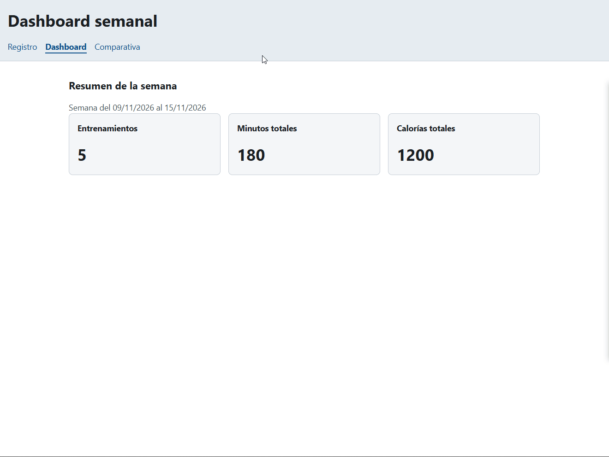
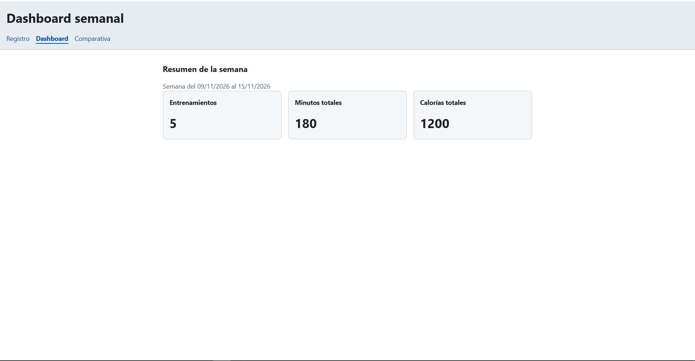
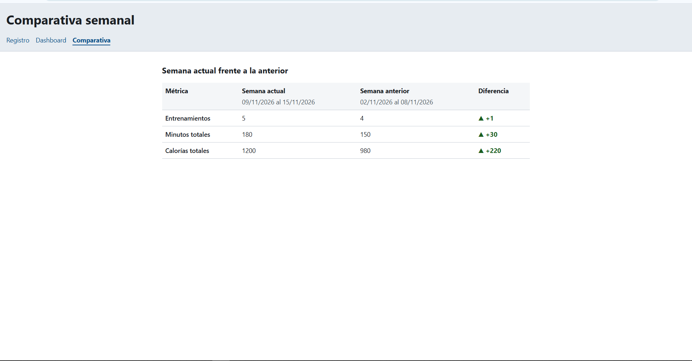
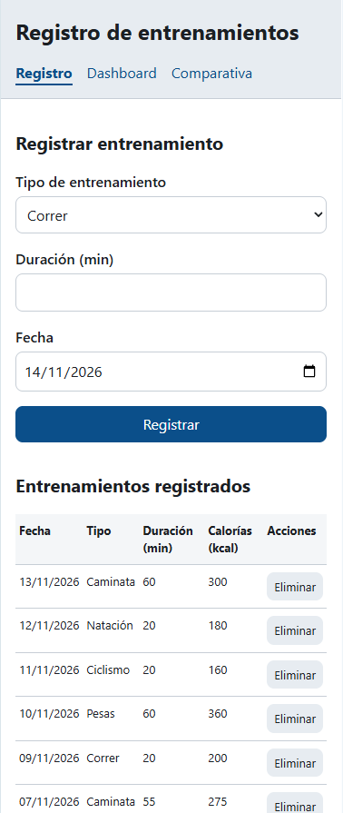

[English](README.md) | **Español**

# Dashboard de Entrenamiento Personal

MVP para un gimnasio: permite registrar entrenamientos, consultar las métricas de la semana actual y compararlas con las de la semana anterior. Es una demo de portafolio construida con Java 21, Spring Boot y PostgreSQL, con una API REST y una interfaz web sencilla en HTML, CSS y JavaScript vanilla.

> **Demo en línea:** https://training-dashboard-hyee.onrender.com. Corre en el plan gratuito de Render con la base en Neon: está siempre encendida, salvo que haya una caída de servidores. No tiene autenticación, así que solo contiene datos ficticios que cualquiera puede crear o eliminar.

## Capturas y demo



*Flujo completo con los datos de demo recién cargados. Los escenarios se detallan más abajo.*

| Dashboard | Comparativa | Vista móvil |
|---|---|---|
|  |  |  |

## Qué demuestra este proyecto

- **API REST por capas**, con arquitectura `Controller → Service → Repository` y DTO como `record`.
- **Reglas de fechas controlables:** las semanas de lunes a domingo se derivan de un `Clock` inyectado, con zona horaria configurable, así que las pruebas usan una fecha fija.
- **Cálculo de calorías en el backend**, sin confiar en el cliente.
- **Manejo uniforme de errores**, con mensajes exactos y probados uno por uno.
- **Pruebas en tres niveles:** unitarias, de integración contra PostgreSQL real y de flujo web con `MockMvc`.
- **Frontend sin frameworks** que consume la API.
- **Datos de demo con fechas relativas**, que se recargan solos cuando la semana actual queda vacía.
- **Despliegue de una aplicación Java en Render mediante Docker**, con una base PostgreSQL en Neon.

## Funcionalidades

- Registrar un entrenamiento: tipo, duración en minutos y fecha. Las calorías se calculan automáticamente.
- Ver la lista de entrenamientos y eliminar los que se registraron por error.
- Dashboard semanal: cantidad de entrenamientos, minutos y calorías de la semana actual.
- Comparativa: semana actual contra semana anterior, con la diferencia y un indicador de subida o bajada.

## Regla de calorías

**Calorías = duración en minutos × kcal por minuto del tipo de entrenamiento.** El cliente nunca envía las calorías: las calcula el backend.

| Tipo | Etiqueta | kcal/min |
|---|---|---:|
| `RUNNING` | Correr | 10 |
| `CYCLING` | Ciclismo | 8 |
| `SWIMMING` | Natación | 9 |
| `WEIGHTS` | Pesas | 6 |
| `WALKING` | Caminata | 5 |

## Stack

- Java 21
- Spring Boot (Web MVC, Data JPA, Bean Validation)
- PostgreSQL (Neon en la demo pública)
- HTML5, CSS3 y JavaScript vanilla (módulos ES)
- Maven
- JUnit, AssertJ, Mockito y MockMvc
- Docker, solo para desplegar en Render

Sin Lombok.

## Arquitectura

```text
Navegador (HTML + JS)
        │  JSON
        ▼
Controller → Service → Repository → PostgreSQL
               │
               └── Clock (fecha y zona horaria inyectadas)
```

- **Controller:** recibe las peticiones, las valida y devuelve DTO.
- **Service:** contiene las reglas de negocio y los cálculos.
- **Repository:** acceso a datos con Spring Data JPA.

El frontend estático lo sirve la misma aplicación: un solo origen y sin CORS.

## Modelo de datos

Una única entidad, `Workout`: `id`, `type`, `durationMinutes`, `calories` y `date`.

## Reglas de negocio

- La duración es un entero de 1 a 1440 minutos.
- La semana va de lunes a domingo y se calcula en el backend con un `Clock` inyectado.
- Las diferencias de la comparativa son `actual - anterior`.
- Se permiten fechas futuras.
- El borrado es definitivo y no hay edición: un registro equivocado se elimina y se vuelve a cargar.

## Rutas

| Operación | Ruta |
|---|---|
| Registrar un entrenamiento | `POST /api/workouts` |
| Listar entrenamientos | `GET /api/workouts` |
| Eliminar un entrenamiento | `DELETE /api/workouts/{id}` |
| Tipos de entrenamiento | `GET /api/workout-types` |
| Dashboard semanal | `GET /api/dashboard/weekly` |
| Comparativa semanal | `GET /api/dashboard/comparison` |

Los errores devuelven `{"message": "...", "fieldErrors": {...}}` con mensajes en español. El detalle de cada ruta y de cada mensaje está en [SPECS.md](SPECS.md).

## Cómo ejecutarlo

Requisitos: Java 21 y PostgreSQL local. El proyecto incluye Maven Wrapper, así que no hace falta instalar Maven.

1. Crea las bases de datos:

   ```bash
   psql -U postgres -c "CREATE DATABASE training_dashboard;"
   psql -U postgres -c "CREATE DATABASE training_dashboard_test;"
   ```

2. Define la contraseña de la base como variable de entorno (nunca se guarda en el repositorio):

   ```bash
   export DB_PASSWORD='la-contraseña-de-tu-base'
   ```

3. Arranca la aplicación con datos de demo:

   ```bash
   SPRING_PROFILES_ACTIVE=demo ./mvnw spring-boot:run
   ```

4. Abre `http://localhost:8080`.

Sin el perfil `demo` la aplicación arranca sin datos.

### Variables de entorno

| Variable | Obligatoria | Por defecto |
|---|---|---|
| `DB_PASSWORD` | Sí | ninguno |
| `DB_URL` | No | `jdbc:postgresql://localhost:5432/training_dashboard` |
| `DB_USERNAME` | No | `postgres` |
| `PORT` | No | `8080` |
| `APP_TIME_ZONE` | No | `America/Guayaquil` |
| `TEST_DB_URL` | No | `jdbc:postgresql://localhost:5432/training_dashboard_test` |

`APP_TIME_ZONE` define los límites de la semana. Detalle en [SPECS.md](SPECS.md) §14.

## Pruebas

```bash
./mvnw test
```

Necesita la base local `training_dashboard_test`. Hay tres niveles: unitarias de los Services con `Clock.fixed`, de integración contra PostgreSQL real (sin H2 ni Testcontainers) y de flujo web con `MockMvc`.

## Escenarios de demo

Con los datos de demo recién cargados:

| # | Escenario | Resultado |
|---|---|---|
| 1 | Abrir el dashboard | 5 entrenamientos, 180 minutos, 1200 kcal |
| 2 | Abrir la comparativa | Semana anterior 4 / 150 / 980; diferencia +1 / +30 / +220 |
| 3 | Registrar Correr, 30 minutos, hoy | 300 kcal; el dashboard pasa a 6 / 210 / 1500 |
| 4 | Registrar con duración 0 | "La duración debe ser mayor que 0" |
| 5 | Eliminar el entrenamiento del escenario 3 | El dashboard vuelve a 5 / 180 / 1200 |

El guion completo está en [SPECS.md](SPECS.md) §15.1.

## Decisiones técnicas

- **Semana derivada, no guardada:** se calcula con un `Clock` inyectado y una zona horaria configurable, para que los límites de la semana no dependan del servidor y las pruebas usen una fecha fija.
- **Calorías en el backend:** el `WorkoutType` guarda el factor y la etiqueta; el cliente solo envía tipo, duración y fecha.
- **Métricas en Java:** una consulta por rango de fechas y la suma en el Service, en un único método que reutilizan el dashboard y la comparativa.
- **DTO como `record`:** las entidades nunca salen del Service.
- **Un solo formato de error:** `ErrorResponse` con mensajes exactos, probados uno por uno.
- **Entrada estricta:** los valores por defecto de Jackson 3 aceptan en silencio cosas como `30.5` (como 30), `"30"` o un tipo numérico; una configuración propia los rechaza para que la API sea predecible.
- **Errores sin filtrar datos:** el 500 devuelve un mensaje genérico y el log registra clases y frames, nunca mensajes, para no exponer credenciales.
- **Frontend sin librerías y con reglas verificadas:** HTML, CSS y módulos ES servidos por la misma aplicación; una prueba Java vigila las convenciones (sin `innerHTML`, sin `var`, sin estilos en línea, sin URL externas) y que cada enlace e import resuelva, y otra comprueba la accesibilidad básica (menú etiquetado, tablas asociadas a su título y botones de borrado distinguibles).
- **Borrado duro sin edición:** un registro equivocado se elimina y se vuelve a cargar; no hay historial que conservar.
- **Fechas futuras permitidas:** evita que un navegador en otra zona horaria falle con la fecha por defecto del formulario.
- **Docker solo para desplegar:** Render exige una imagen para Java; el desarrollo sigue sin Docker.
- **Demo que se mantiene sola:** los datos tienen fechas relativas y envejecen, así que una revisión al arrancar y otra diaria los reemplazan cuando la semana actual queda vacía; si la recarga falla, se conservan los datos y la aplicación sigue funcionando.

## Limitaciones conocidas

- La semana actual está incompleta hasta el domingo y se compara contra una semana anterior completa: al inicio de la semana las diferencias salen negativas.
- Los datos de demo se recargan solos cuando la semana actual queda vacía (al arrancar y una vez al día): los entrenamientos que agregue cualquier visitante se pierden en cada recarga.
- Sin autenticación ni usuarios: los datos son globales.

## Alcance excluido

Autenticación y usuarios, rutinas y ejercicios, metas, notificaciones, exportación, edición de entrenamientos, paginación, porcentajes, gráficos, frameworks de frontend, microservicios, Redis, CI/CD e infraestructura como código. Lista completa en [SPECS.md](SPECS.md) §3.

## Despliegue

La demo pública corre en Render con la base de datos en Neon. Render no ejecuta Java de forma nativa, por eso el repositorio incluye un `Dockerfile`: es el único uso de Docker del proyecto y no se usa en local. La configuración se hace con variables de entorno desde el panel de Render, sin credenciales en el repositorio. Como la aplicación no tiene autenticación, cualquiera con la URL puede crear y eliminar datos, así que la demo solo contiene datos ficticios. Detalle en [SPECS.md](SPECS.md) §17.

## Documentación del proyecto

| Archivo | Contenido |
|---|---|
| [SPECS.md](SPECS.md) | Qué se construye: alcance, reglas, modelo, rutas y criterios |
| [CODESTYLE.md](CODESTYLE.md) | Cómo se escribe el código |
| [ROADMAP.md](ROADMAP.md) | En qué orden se construye |
| [AGENTS.md](AGENTS.md) | Instrucciones para agentes de IA y colaboradores |
| [LICENSE](LICENSE) | Licencia MIT |
