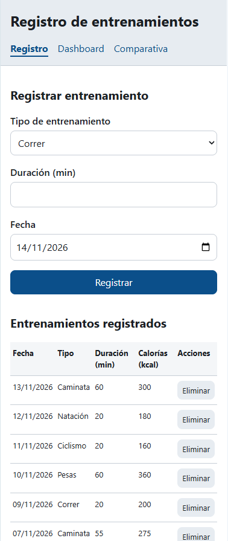

# Dashboard de Entrenamiento Personal

MVP para un gimnasio: permite registrar entrenamientos, consultar las métricas de la semana actual y compararlas con las de la semana anterior. Es una API REST en **Java 21 + Spring Boot + PostgreSQL** con una interfaz web sencilla en HTML, CSS y JavaScript vanilla.

**Demo en línea:** se publica al cerrar la Fase 10 del [ROADMAP](ROADMAP.md).

## Qué demuestra este proyecto

- Diseño de una API REST por capas (`Controller` → `Service` → `Repository`) con DTO como `record`.
- Lógica de negocio con reglas de fechas: semanas de lunes a domingo derivadas de un `Clock` inyectado, con zona horaria configurable.
- Cálculo de calorías en el backend, sin confiar en el cliente.
- Manejo uniforme de errores con mensajes exactos y probados.
- Pruebas en tres niveles: unitarias, de integración contra PostgreSQL real y de flujo web con `MockMvc`.
- Frontend sin frameworks consumiendo la API.
- Despliegue de una aplicación Java en Render mediante Docker, con una base PostgreSQL en Neon.

## Funcionalidades

- Registrar un entrenamiento: tipo, duración en minutos y fecha. Las calorías se calculan automáticamente.
- Ver la lista de entrenamientos y eliminar los que se registraron por error.
- Dashboard semanal: cantidad de entrenamientos, minutos y calorías de la semana actual.
- Comparativa: semana actual contra semana anterior, con la diferencia y un indicador de subida o bajada.

## Capturas


| Dashboard | Comparativa | Vista móvil |
|---|---|---|
|  |  |  |

## Stack

| Capa | Tecnología |
|---|---|
| Lenguaje | Java 21 |
| Framework | Spring Boot (Web MVC, Data JPA, Bean Validation) |
| Base de datos | PostgreSQL |
| Frontend | HTML5, CSS3 y JavaScript vanilla (módulos ES) |
| Construcción | Maven |
| Pruebas | JUnit, AssertJ, Mockito y MockMvc |
| Despliegue | Render (Docker) + Neon |

## Arquitectura

```text
Navegador (HTML + JS)
        │  JSON
        ▼
Controller → Service → Repository → PostgreSQL
               │
               └── Clock (fecha y zona horaria inyectadas)
```

El frontend estático lo sirve la misma aplicación: un solo origen y sin CORS. La lógica vive solo en los Services; los controllers reciben, validan y devuelven DTO.

## Modelo y reglas

Una única entidad, `Workout`: `id`, `type`, `durationMinutes`, `calories` y `date`.

| Tipo | Etiqueta | kcal/min |
|---|---|---:|
| `RUNNING` | Correr | 10 |
| `CYCLING` | Ciclismo | 8 |
| `SWIMMING` | Natación | 9 |
| `WEIGHTS` | Pesas | 6 |
| `WALKING` | Caminata | 5 |

- `calories = durationMinutes × kcal/min`. El cliente nunca envía las calorías.
- La duración es un entero de 1 a 1440 minutos.
- La semana va de lunes a domingo y se calcula en el backend. Las diferencias de la comparativa son `actual - anterior`.

## API

| Operación | Ruta |
|---|---|
| Registrar un entrenamiento | `POST /api/workouts` |
| Listar entrenamientos | `GET /api/workouts` |
| Eliminar un entrenamiento | `DELETE /api/workouts/{id}` |
| Tipos de entrenamiento | `GET /api/workout-types` |
| Dashboard semanal | `GET /api/dashboard/weekly` |
| Comparativa semanal | `GET /api/dashboard/comparison` |

Los errores devuelven `{"message": "...", "fieldErrors": {...}}` con mensajes en español. El detalle de cada ruta y de cada mensaje está en [SPECS.md](SPECS.md).

## Cómo ejecutar

Requisitos: Java 21 y PostgreSQL local.

```bash
psql -U postgres -c "CREATE DATABASE training_dashboard;"
psql -U postgres -c "CREATE DATABASE training_dashboard_test;"
export DB_PASSWORD='la-contraseña-de-tu-base'
./mvnw spring-boot:run
```

Abrir `http://localhost:8080`. Para cargar los datos de demo:

```bash
SPRING_PROFILES_ACTIVE=demo ./mvnw spring-boot:run
```

`DB_PASSWORD` es obligatoria y no tiene valor por defecto. Las demás variables (`DB_URL`, `DB_USERNAME`, `PORT`, `APP_TIME_ZONE`) son opcionales; los valores por defecto están en el [SPECS §14](SPECS.md).

## Escenarios de demo

Con los datos de demo recién cargados:

| # | Escenario | Resultado |
|---|---|---|
| 1 | Abrir el dashboard | 5 entrenamientos, 180 minutos, 1200 kcal |
| 2 | Abrir la comparativa | Semana anterior 4 / 150 / 980; diferencia +1 / +30 / +220 |
| 3 | Registrar Correr, 30 minutos, hoy | 300 kcal; el dashboard pasa a 6 / 210 / 1500 |
| 4 | Registrar con duración 0 | "La duración debe ser mayor que 0" |
| 5 | Eliminar el entrenamiento del escenario 3 | El dashboard vuelve a 5 / 180 / 1200 |

## Pruebas

```bash
./mvnw test
```

Necesita la base local `training_dashboard_test`. Hay tres niveles: unitarias de los Services con `Clock.fixed`, integración contra PostgreSQL real (sin H2 ni Testcontainers) y flujo web con `MockMvc`.

## Despliegue

La demo corre en Render con la base de datos en Neon. Render no ejecuta Java de forma nativa, por eso el repositorio incluye un `Dockerfile`: es el único uso de Docker del proyecto, no se usa en local. El detalle está en el [SPECS §17](SPECS.md).

- La primera visita puede tardar si el servicio estaba dormido.
- La aplicación no tiene autenticación: cualquiera con la URL puede crear y eliminar datos, así que la demo solo contiene datos ficticios.

## Decisiones técnicas

- **Semana derivada, no guardada:** se calcula con un `Clock` inyectado y una zona horaria configurable, para que los límites de la semana no dependan del servidor y las pruebas usen una fecha fija.
- **Calorías en el backend:** el `WorkoutType` guarda el factor y la etiqueta; el cliente solo envía tipo, duración y fecha.
- **Métricas en Java:** una consulta por rango de fechas y la suma en el Service, en un único método que reutilizan el dashboard y la comparativa.
- **DTO como `record`:** las entidades nunca salen del Service.
- **Un solo formato de error:** `ErrorResponse` con mensajes exactos, probados uno por uno.
- **Entrada estricta:** los valores por defecto de Jackson 3 aceptan en silencio cosas como `30.5` (como 30), `"30"` o un tipo numérico; una configuración propia los rechaza para que la API sea predecible.
- **Errores sin filtrar datos:** el 500 devuelve un mensaje genérico y el log registra clases y frames, nunca mensajes, para no exponer credenciales.
- **Borrado duro sin edición:** un registro equivocado se elimina y se vuelve a cargar; no hay historial que conservar.
- **Fechas futuras permitidas:** evita que un navegador en otra zona horaria falle con la fecha por defecto del formulario.
- **Docker solo para desplegar:** Render exige una imagen para Java; el desarrollo sigue sin Docker.
- **Demo que se mantiene sola:** los datos tienen fechas relativas y envejecen, así que una revisión al arrancar y otra diaria los reemplaza cuando la semana actual queda vacía; si la recarga falla, se conservan los datos y la aplicación sigue funcionando.

## Limitaciones conocidas

- La semana actual está incompleta hasta el domingo y se compara contra una semana anterior completa: al inicio de la semana las diferencias salen negativas.
- Los datos de demo se recargan solos cuando la semana actual queda vacía (al arrancar y una vez al día): los entrenamientos que agregue cualquier visitante se pierden en cada recarga.
- Sin autenticación ni usuarios: los datos son globales.

## Alcance excluido

Autenticación y usuarios, rutinas y ejercicios, metas, notificaciones, exportación, edición de entrenamientos, paginación, porcentajes, gráficos, frameworks de frontend, microservicios, Redis, CI/CD e infraestructura como código. La lista completa está en el [SPECS §3](SPECS.md).

## Documentación

- [SPECS.md](SPECS.md): fuente de verdad del proyecto.
- [CODESTYLE.md](CODESTYLE.md): reglas de código.
- [ROADMAP.md](ROADMAP.md): fases de desarrollo.
- [AGENTS.md](AGENTS.md): instrucciones para agentes de IA y contribuciones.
