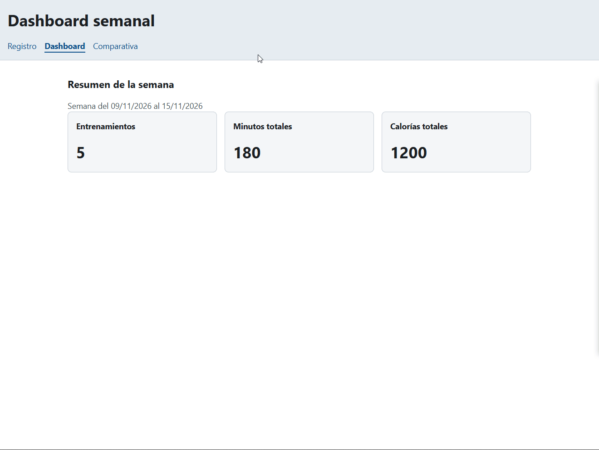
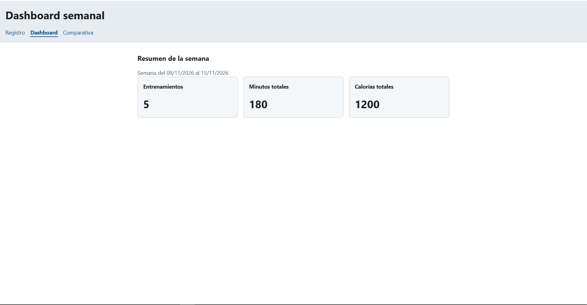
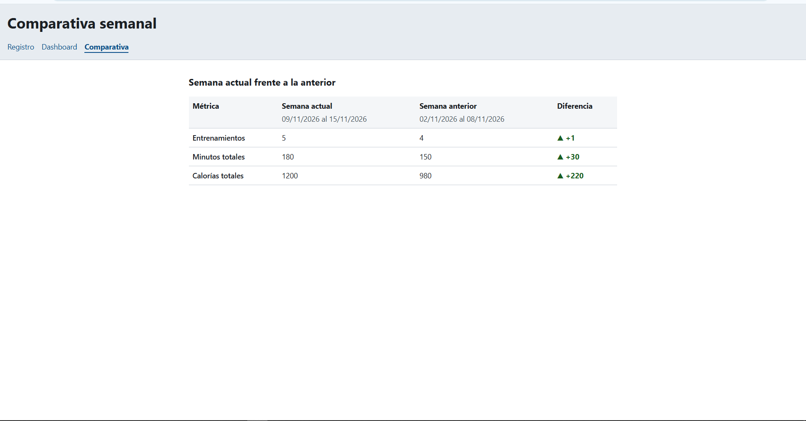

**English** | [Español](README.es.md)

# Personal Training Dashboard

MVP for a gym: it lets you log workouts, see the metrics for the current week and compare them with the previous week. It is a portfolio demo built with Java 21, Spring Boot and PostgreSQL, with a REST API and a simple web interface in HTML, CSS and vanilla JavaScript.

> **Live demo:** https://training-dashboard-hyee.onrender.com. It runs on Render's free plan with the database on Neon and is always on, unless there is a server outage. It has no authentication, so it only contains fictional data that anyone can create or delete.

## Screenshots and demo



*Full flow with freshly loaded demo data. The scenarios are described below.*

| Dashboard | Comparison | Mobile view |
|---|---|---|
|  |  |  |

## What this project demonstrates

- **Layered REST API**, with a `Controller → Service → Repository` architecture and DTOs as `record`.
- **Controllable date rules:** weeks from Monday to Sunday are derived from an injected `Clock`, with a configurable time zone, so tests use a fixed date.
- **Calorie calculation in the backend**, without trusting the client.
- **Uniform error handling**, with exact messages tested one by one.
- **Tests at three levels:** unit tests, integration tests against a real PostgreSQL database, and web flow tests with `MockMvc`.
- **Frontend without frameworks** that consumes the API.
- **Demo data with relative dates**, which reloads itself when the current week is empty.
- **Deployment of a Java application on Render using Docker**, with a PostgreSQL database on Neon.

## Features

- Log a workout: type, duration in minutes and date. Calories are calculated automatically.
- See the list of workouts and delete the ones logged by mistake.
- Weekly dashboard: number of workouts, minutes and calories for the current week.
- Comparison: current week against previous week, with the difference and an up or down indicator.

## Calorie rule

**Calories = duration in minutes × kcal per minute of the workout type.** The client never sends the calories: the backend calculates them.

| Type | Label (in the interface, in Spanish) | kcal/min |
|---|---|---:|
| `RUNNING` | Correr | 10 |
| `CYCLING` | Ciclismo | 8 |
| `SWIMMING` | Natación | 9 |
| `WEIGHTS` | Pesas | 6 |
| `WALKING` | Caminata | 5 |

## Tech stack

- Java 21
- Spring Boot (Web MVC, Data JPA, Bean Validation)
- PostgreSQL (Neon in the public demo)
- HTML5, CSS3 and vanilla JavaScript (ES modules)
- Maven
- JUnit, AssertJ, Mockito and MockMvc
- Docker, only to deploy on Render

No Lombok.

## Architecture

```text
Browser (HTML + JS)
        │  JSON
        ▼
Controller → Service → Repository → PostgreSQL
               │
               └── Clock (injected date and time zone)
```

- **Controller:** receives requests, validates them and returns DTOs.
- **Service:** contains the business rules and the calculations.
- **Repository:** data access with Spring Data JPA.

The static frontend is served by the same application: a single origin and no CORS.

## Data model

A single entity, `Workout`: `id`, `type`, `durationMinutes`, `calories` and `date`.

## Business rules

- Duration is an integer from 1 to 1440 minutes.
- The week runs from Monday to Sunday and is calculated in the backend with an injected `Clock`.
- The differences in the comparison are `current - previous`.
- Future dates are allowed.
- Deletion is permanent and there is no editing: a wrong record is deleted and loaded again.

## Routes

| Operation | Route |
|---|---|
| Log a workout | `POST /api/workouts` |
| List workouts | `GET /api/workouts` |
| Delete a workout | `DELETE /api/workouts/{id}` |
| Workout types | `GET /api/workout-types` |
| Weekly dashboard | `GET /api/dashboard/weekly` |
| Weekly comparison | `GET /api/dashboard/comparison` |

Errors return `{"message": "...", "fieldErrors": {...}}` with messages in Spanish. The detail of each route and each message is in [SPECS.md](SPECS.md).

## How to run it

Requirements: Java 21 and a local PostgreSQL. The project includes the Maven Wrapper, so you do not need to install Maven.

1. Create the databases:

   ```bash
   psql -U postgres -c "CREATE DATABASE training_dashboard;"
   psql -U postgres -c "CREATE DATABASE training_dashboard_test;"
   ```

2. Set the database password as an environment variable (it is never saved in the repository):

   ```bash
   export DB_PASSWORD='your-database-password'
   ```

3. Start the application with demo data:

   ```bash
   SPRING_PROFILES_ACTIVE=demo ./mvnw spring-boot:run
   ```

4. Open `http://localhost:8080`.

Without the `demo` profile, the application starts with no data.

### Environment variables

| Variable | Required | Default |
|---|---|---|
| `DB_PASSWORD` | Yes | none |
| `DB_URL` | No | `jdbc:postgresql://localhost:5432/training_dashboard` |
| `DB_USERNAME` | No | `postgres` |
| `PORT` | No | `8080` |
| `APP_TIME_ZONE` | No | `America/Guayaquil` |
| `TEST_DB_URL` | No | `jdbc:postgresql://localhost:5432/training_dashboard_test` |

`APP_TIME_ZONE` sets the week limits. Details in [SPECS.md](SPECS.md) §14.

## Tests

```bash
./mvnw test
```

It needs the local database `training_dashboard_test`. There are three levels: unit tests of the Services with `Clock.fixed`, integration tests against a real PostgreSQL database (no H2 or Testcontainers), and web flow tests with `MockMvc`.

## Demo scenarios

With freshly loaded demo data:

| # | Scenario | Result |
|---|---|---|
| 1 | Open the dashboard | 5 workouts, 180 minutes, 1200 kcal |
| 2 | Open the comparison | Previous week 4 / 150 / 980; difference +1 / +30 / +220 |
| 3 | Log Running, 30 minutes, today | 300 kcal; the dashboard changes to 6 / 210 / 1500 |
| 4 | Log with duration 0 | "La duración debe ser mayor que 0" (error message, in Spanish) |
| 5 | Delete the workout from scenario 3 | The dashboard goes back to 5 / 180 / 1200 |

The full script is in [SPECS.md](SPECS.md) §15.1.

## Technical decisions

- **Week derived, not stored:** it is calculated with an injected `Clock` and a configurable time zone, so the week limits do not depend on the server and tests use a fixed date.
- **Calories in the backend:** `WorkoutType` holds the factor and the label; the client only sends type, duration and date.
- **Metrics in Java:** one query by date range and the sum in the Service, in a single method reused by the dashboard and the comparison.
- **DTOs as `record`:** entities never leave the Service.
- **A single error format:** `ErrorResponse` with exact messages, tested one by one.
- **Strict input:** the default settings of Jackson 3 silently accept things like `30.5` (as 30), `"30"` or a numeric type; a custom configuration rejects them so the API is predictable.
- **Errors that do not leak data:** the 500 error returns a generic message and the log records classes and frames, never messages, to avoid exposing credentials.
- **Frontend without libraries and with verified rules:** HTML, CSS and ES modules served by the same application; a Java test checks the conventions (no `innerHTML`, no `var`, no inline styles, no external URLs) and that every link and import resolves, and another one checks basic accessibility (labeled menu, tables linked to their caption and distinguishable delete buttons).
- **Hard delete, no editing:** a wrong record is deleted and loaded again; there is no history to keep.
- **Future dates allowed:** this avoids a browser in another time zone failing with the form's default date.
- **Docker only to deploy:** Render needs an image for Java; development stays without Docker.
- **Self-maintaining demo:** the data uses relative dates and gets old, so a check at startup and another one every day replace it when the current week is empty; if the reload fails, the data is kept and the application keeps working.

## Known limitations

- The current week is incomplete until Sunday and is compared with a complete previous week: at the start of the week the differences are negative.
- The demo data reloads itself when the current week is empty (at startup and once a day): workouts added by any visitor are lost on each reload.
- No authentication or users: the data is global.

## Out of scope

Authentication and users, routines and exercises, goals, notifications, export, workout editing, pagination, percentages, charts, frontend frameworks, microservices, Redis, CI/CD and infrastructure as code. Full list in [SPECS.md](SPECS.md) §3.

## Deployment

The public demo runs on Render with the database on Neon. Render does not run Java natively, so the repository includes a `Dockerfile`: it is the only use of Docker in the project and it is not used locally. Configuration is done with environment variables from the Render dashboard, with no credentials in the repository. Since the application has no authentication, anyone with the URL can create and delete data, so the demo only contains fictional data. Details in [SPECS.md](SPECS.md) §17.

## AI-assisted development

This project was built with a spec-driven workflow using AI coding agents (Claude, and opencode with DeepSeek). The scope and decisions are written down first in the specification and the phased roadmap, and the rules for the agents live in `AGENTS.md`. Each phase is closed after reviewing the code changes, testing the running app by hand and passing the automated tests. See *Project documentation* below.

## Project documentation

The project documents are written in Spanish.

| File | Content |
|---|---|
| [SPECS.md](SPECS.md) | What is built: scope, rules, model, routes and criteria |
| [CODESTYLE.md](CODESTYLE.md) | How the code is written |
| [ROADMAP.md](ROADMAP.md) | In what order it is built |
| [AGENTS.md](AGENTS.md) | Instructions for AI agents and contributors |
| [LICENSE](LICENSE) | MIT license |

